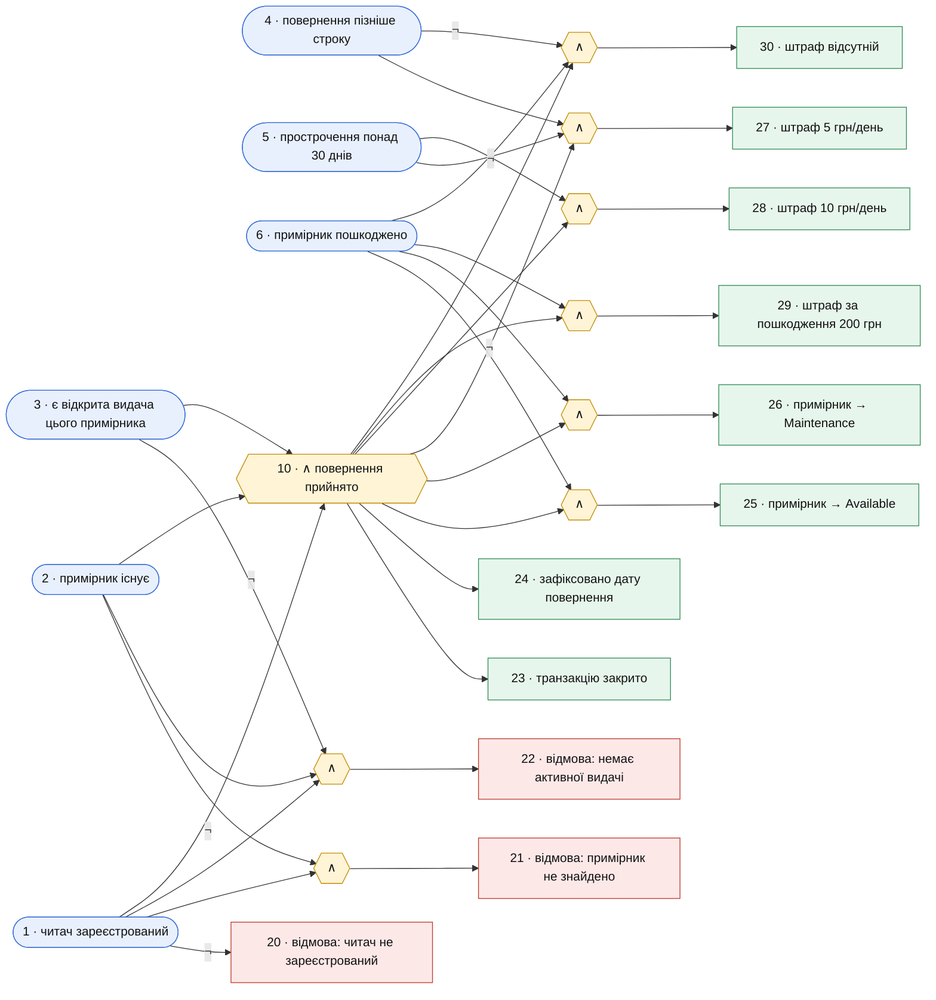

# Функціональна діаграма операції returnBook / calculateFine

## Причини

| № | Причина |
|---|---------|
| 1 | Читач зареєстрований |
| 2 | Примірник існує в реєстрі |
| 3 | У читача є відкрита видача цього примірника |
| 4 | Дата повернення пізніша за строк повернення |
| 5 | Прострочення становить понад 30 днів |
| 6 | Примірник повернено пошкодженим |

## Наслідки

| № | Наслідок |
|---|----------|
| 20 | Відмова: читач не зареєстрований |
| 21 | Відмова: примірник не знайдено |
| 22 | Відмова: немає активної видачі |
| 23 | Транзакцію закрито |
| 24 | Зафіксовано фактичну дату повернення |
| 25 | Примірник переходить у стан Available |
| 26 | Примірник переходить у стан Maintenance |
| 27 | Штраф за прострочення 5 грн/день |
| 28 | Штраф за прострочення 10 грн/день |
| 29 | Штраф за пошкодження 200 грн |
| 30 | Штраф відсутній |

Проміжна вершина 10 — «повернення прийнято».

## Діаграма

## Обмеження

| Обмеження | Зміст |
|-----------|-------|
| I (1, ¬3) | Хоча б одне істинне: читач зареєстрований або відкритої видачі немає |
| I (2, ¬3) | Хоча б одне істинне: примірник існує або відкритої видачі немає |
| I (4, ¬5) | Хоча б одне істинне: є прострочення або воно не перевищує 30 днів |
| O (20, 21, 22, 23) | Істинний рівно один результат: одна з відмов або закриття транзакції |
| R (23, 24) | Транзакцію закрито тоді й лише тоді, коли зафіксовано дату повернення |
| E (25, 26) | Примірник не може одночасно стати Available і Maintenance |
| E (27, 28) | Звичайний і підвищений штраф за прострочення не нараховуються разом |
| M (30; 27, 28, 29) | Якщо штраф відсутній, жоден штраф не нарахований, і навпаки |

## Таблиця рішень

| | T1 | T2 | T3 | T4 | T5 | T6 | T7 | T8 | T9 |
|---|---|---|---|---|---|---|---|---|---|
| 1 | 0 | 1 | 1 | 1 | 1 | 1 | 1 | 1 | 1 |
| 2 | X | 0 | 1 | 1 | 1 | 1 | 1 | 1 | 1 |
| 3 | X | X | 0 | 1 | 1 | 1 | 1 | 1 | 1 |
| 4 | X | X | X | 0 | 0 | 1 | 1 | 1 | 1 |
| 5 | X | X | X | 0 | 0 | 0 | 0 | 1 | 1 |
| 6 | X | X | X | 0 | 1 | 0 | 1 | 0 | 1 |
| 20 | V | | | | | | | | |
| 21 | | V | | | | | | | |
| 22 | | | V | | | | | | |
| 23 | | | | V | V | V | V | V | V |
| 24 | | | | V | V | V | V | V | V |
| 25 | | | | V | | V | | V | |
| 26 | | | | | V | | V | | V |
| 27 | | | | | | V | V | | |
| 28 | | | | | | | | V | V |
| 29 | | | | | V | | V | | V |
| 30 | | | | V | | | | | |
